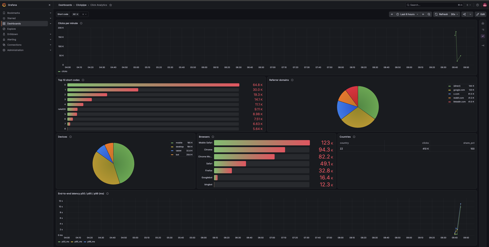
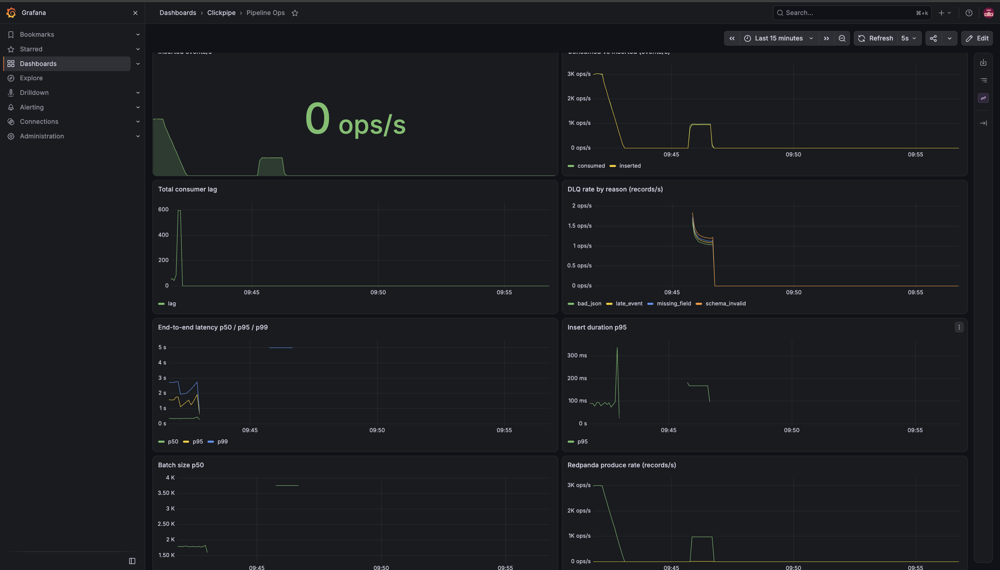
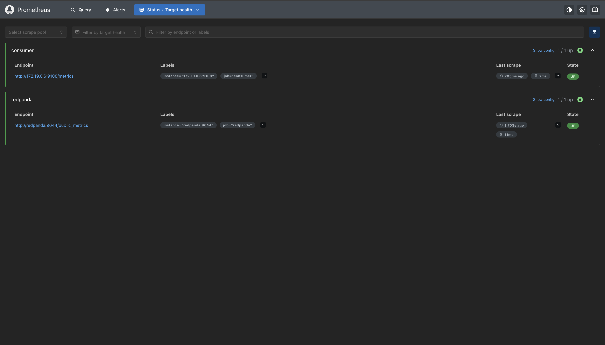
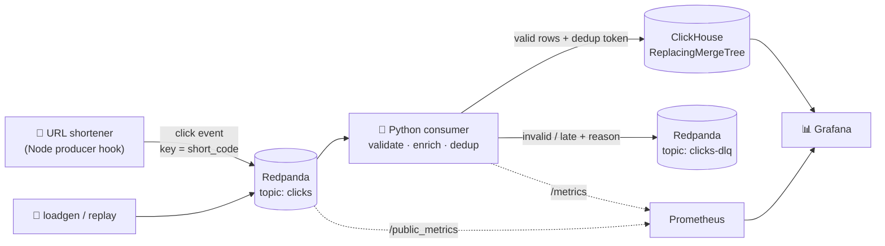

<div align="center">

# ⚡ ClickPipe

### Real-time click analytics for a URL shortener

**Every redirect becomes exactly one stored click — no loss on crashes, no double counting on replays.**

[](https://github.com/ARYAN10227/clickstream-pipeline/actions/workflows/ci.yml)


**20,000 events/s** sustained · **p99 397 ms** end-to-end · **0 duplicates** in a 1M-event replay · **0 lost** after `kill -9`

[](https://codespaces.new/ARYAN10227/clickstream-pipeline?quickstart=1)



</div>

---

## 📖 What it does

A user opens a short link → the [URL shortener](https://github.com/ARYAN10227/url-shortener) fires a click event
(without slowing the redirect) → **Redpanda** buffers it → a **Python consumer** validates, enriches and
stores it in **ClickHouse** → **Grafana** shows live analytics and pipeline health.

Bad or late events are never silently dropped: they go to a **dead-letter topic** with the reason attached.

## 📊 Results

Measured on **v1.0.0** — one cloud VM, Intel Xeon @ 2.10 GHz, **4 vCPUs**, 15.7 GiB RAM, with the
**whole stack** (Redpanda, ClickHouse, consumer, Prometheus, Grafana and the load generator) on that
one machine and **1 consumer replica**. Every number links to the file it came from
([full report](docs/results/final-v1.md)).

| | Result | Target | |
|---|---|---|:-:|
| 🚀 **Sustained throughput** | 6,000,000 events in 300 s — consumer **20,083 events/s**, lag drained to 0 | ≥ 20,000/s for 5 min | ✅ [source](docs/results/bench-20261019T204939.md) |
| ⏱️ **End-to-end latency** | p50 **215 ms** · p95 **341 ms** · p99 **397 ms** | p99 < 2 s | ✅ [source](docs/results/bench-20261019T204939.md) |
| 📈 **Headroom** | consumer kept up at **29,968 events/s** for 120 s, p99 929 ms, lag drained to 0 | — | ℹ️ [source](docs/results/bench-20261019T205515.md) |
| 🔁 **Duplicates after 1M replay** | 1,000,000 unique stored exactly once despite **50,000 injected duplicates** | 0 | ✅ [source](docs/results/verify-20261019T205727.md) |
| 💥 **Loss after `kill -9`** | 300,000 sent → 300,000 stored; **4,401 redelivered rows collapsed** by dedup | 0 | ✅ [source](docs/results/crash-20261019T205905.md) |
| 🗑️ **Bad records to DLQ** | **20,000 / 20,000** routed with the right reason | 100% | ✅ [source](docs/results/verify-20261019T205727.md) |
| 🧪 **Test coverage** | **82.66%** (157 unit + integration tests) | ≥ 80% | ✅ [source](docs/results/coverage.txt) |

> The headroom run was 120 s, so it doesn't count against the 300 s throughput target (its formal
> check shows FAIL for that reason). Earlier runs — including a first baseline that missed by 1 event/s
> because of a load-generator bug, since fixed — are kept in [docs/results/](docs/results/README.md).

## 🖼️ Dashboards

<table>
<tr>
<td width="50%"><b>Pipeline Ops</b> — throughput, consumer lag, DLQ rate by reason, latency percentiles<br/></td>
<td width="50%"><b>Prometheus targets</b> — consumer and Redpanda both scraped and healthy<br/></td>
</tr>
</table>

Both dashboards are provisioned as code from [`infra/grafana/dashboards/`](infra/grafana/dashboards)
and load automatically on `make up`.

## 🏗️ Architecture



**Every batch, in this exact order:**

```
poll → validate → insert into ClickHouse (with dedup token) → send bad records to DLQ → flush DLQ → commit offsets
```

Offsets are committed **only after** the insert and the DLQ flush both succeed. A crash at any point
means redelivery, never loss — and redelivery is harmless because writes are idempotent.
The full sequence and every failure scenario are in [docs/architecture.md](docs/architecture.md).

## ✨ Features

- **🔌 Non-blocking producer hook** — [`integrations/node-producer`](integrations/node-producer): one
  `recordClick(req, code)` call after the redirect. It never blocks or throws.
- **🛡️ Idempotent storage, two layers** — a hashed per-batch `insert_deduplication_token` skips retried
  batches, and a ReplacingMergeTree keyed on the producer-assigned `event_id` collapses everything else.
- **🧹 Data-quality rules** — `bad_json`, `missing_field`, `schema_invalid`, `late_event`, `future_event`,
  each routed to the DLQ with the original bytes and source offset as headers.
- **🧭 Enrichment** — referrer domain, device class, browser, and country via optional GeoIP.
  Raw IPs are never stored.
- **🔄 Safe failure handling** — retries with backoff, graceful shutdown, and a hard rule: never commit
  what wasn't stored.
- **📡 Observability** — Prometheus metrics (throughput, lag, DLQ by reason, batch size, insert
  duration, end-to-end latency) and two Grafana dashboards.
- **✅ Proof built in** — `make bench`, `make replay` and `make crash-test` each write a PASS/FAIL report.

## 🚀 Quick start

### ☁️ Try it in your browser (no install)

Click **[Open in GitHub Codespaces](https://codespaces.new/ARYAN10227/clickstream-pipeline?quickstart=1)**.
The whole stack starts by itself in about 3–5 minutes, and Grafana opens on port 3000
(`admin` / `change_me`). Then run `uv run python tools/loadgen.py --rate 2000 --duration 120`
in the terminal and watch the dashboards fill. It runs on your own free Codespaces quota
(4-core machine) — stop the Codespace when you're done.

### 💻 Run it locally

Needs **Docker** (with Compose) and **[uv](https://docs.astral.sh/uv/)**.

```sh
cp .env.example .env
make up      # starts everything and runs a smoke check
make bench   # 20,000 events/s for 300 s → report in docs/results/
```

| | URL | Login |
|---|---|---|
| Grafana | http://localhost:3000 | `admin` / `GRAFANA_ADMIN_PASSWORD` from `.env` |
| Prometheus | http://localhost:9090/targets | — |
| Consumer metrics | http://localhost:9108/metrics | — |
| ClickHouse | http://localhost:8123/play | `clickpipe` / `CLICKHOUSE_PASSWORD` from `.env` |

Send some traffic and watch the dashboards fill:

```sh
uv run python tools/loadgen.py --rate 3000 --duration 120   # valid clicks
uv run python tools/replay.py --n 50000                     # includes duplicates and bad records
```

`make help` lists every command. A 2-minute walkthrough is in [docs/demo.md](docs/demo.md).

## 🔬 How correctness is proven

| Tool | What it does | What it checks |
|---|---|---|
| `make replay` | Sends N unique events + byte-identical duplicates + invalid and late records | `count() FINAL` = `uniqExact(event_id)` = N, and the DLQ holds exactly the expected records per reason |
| `make crash-test` | `SIGKILL`s the consumer mid-stream, restarts it | Zero loss and zero duplicates, plus how many redelivered rows dedup collapsed |
| `make bench` | Load at a fixed rate, samples lag, measures latency | Throughput and p99 against the SPEC targets |

Both correctness tools also run as e2e tests in [`tests/e2e`](tests/e2e).

## 🧠 Design decisions

| Decision | Instead of | Why |
|---|---|---|
| [Custom Python consumer](docs/decisions/0001-custom-python-consumer.md) | ClickHouse Kafka engine | DLQ routing, reason codes and commit-after-insert stay testable |
| [At-least-once + idempotent writes](docs/decisions/0002-at-least-once-plus-idempotent-writes.md) | Kafka transactions | Transactions can't cover an external ClickHouse write |
| [Two-layer deduplication](docs/decisions/0003-two-layer-deduplication.md) | A Redis "seen IDs" set | Survives crashes, no unbounded memory, correctness lives in storage |
| [JSON + Pydantic](docs/decisions/0004-json-pydantic-schema.md) | Avro + schema registry | Fewer moving parts on one machine; Avro is the 10× upgrade |
| [Dead-letter topic](docs/decisions/0005-dead-letter-topic.md) | Log-and-drop | Bad data is kept and can be replayed after a fix |

## ⚙️ Performance work

- **Profiled with py-spy** at 20,000 events/s ([notes](docs/results/profile-notes.md),
  [flame graph](docs/results/profile-baseline.svg)): the consumer was CPU-bound (≈76% computing,
  ≈24% waiting). The biggest avoidable cost was a timestamp round trip — building `datetime`
  objects that the ClickHouse driver immediately converted back to integers.
- **Fix:** pass timestamps as epoch-ms integers. p50 230 → 209 ms, max 993 → 779 ms
  ([report](docs/results/perf-20261019T201758.md)).
- **1 vs 3 consumers** ([scaling.md](docs/results/scaling.md)): 3 replicas did **not** beat 1 on 4 shared
  vCPUs. ClickHouse saw the same insert pattern either way, so the likely cause is CPU contention,
  not partition parallelism.
- **Found by review:** a silent data-loss case where new events at reused offsets could be skipped as
  "duplicates" — fixed by hashing `event_id`s into the dedup token, with a regression test.

## 🧪 Testing

| Suite | Command | Needs | Covers |
|---|---|---|---|
| Unit | `make test` | nothing | validation, enrichment, dedup tokens, retries, insert → DLQ → commit ordering, metrics |
| Integration | `make test-int` | Docker | the consumer against real Redpanda + ClickHouse (testcontainers) |
| E2E | `make test-e2e` | `make up` | happy path, replay with duplicates, `kill -9` recovery |
| Coverage | `make cov` | Docker | unit + integration, fails under 80% |
| Lint | `make lint` | nothing | ruff check + format |

CI ([workflow](.github/workflows/ci.yml)) runs lint and unit tests on every push and pull request.

## 🗺️ Limitations and roadmap

- **Single broker** — one Redpanda node is a single point of failure; production needs 3 nodes.
- **No pre-aggregation** — dashboards query the raw table; materialized views would keep them fast as data grows.
- **Avro + schema registry** — the upgrade path for many producers.
- **GeoIP is optional** — without a GeoLite2 file, country shows as `ZZ` (unknown).
- **Where it breaks at 10×** ([details](docs/results/scaling.md#where-this-design-breaks-at-10x-200000-eventss)) —
  partition count caps consumers, single broker, ClickHouse merge rate, Python validation cost.

## 📁 Project structure

```
src/clickpipe/              consumer, schema + validation, enrichment, sink, DLQ, dedup, metrics
tools/                      loadgen, replay, verify, crash test, bench, latency report
integrations/node-producer/ drop-in click producer for the URL shortener
infra/                      Prometheus config, Grafana datasources + dashboards
sql/                        ClickHouse schema and dashboard queries
tests/                      unit, integration, e2e
docs/                       architecture, design decisions, results, demo script
```

---

<div align="center">

### 👋 Built by Aryan Raj

Backend developer · Node.js, Redis, Docker, distributed systems

[](https://github.com/ARYAN10227)
[](https://linkedin.com/in/aryan-raj-2b3868340)
[](https://leetcode.com/u/aryanraj01)
[](mailto:aryanrajpersonal12@gmail.com)

⭐ If you found this useful, consider giving it a star!

</div>
