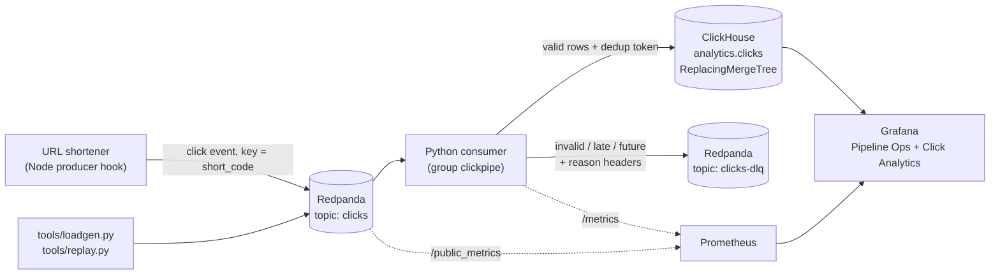

# Real-Time Click-Event Pipeline

Streams URL-shortener click events through Redpanda into ClickHouse with idempotent writes,
a dead-letter queue and Grafana monitoring. Every redirect becomes one stored click, with no
loss on crashes and no double counting on replays.

[](https://github.com/ARYAN10227/clickstream-pipeline/actions/workflows/ci.yml)

## Quick start

Needs Docker (with Compose) and [uv](https://docs.astral.sh/uv/).

```sh
cp .env.example .env
make up      # Redpanda, ClickHouse, consumer, Prometheus, Grafana + a smoke check
make bench   # RATE=20000 DURATION=300 by default; results land in docs/results/
```

- Grafana: http://localhost:3000 (admin / `GRAFANA_ADMIN_PASSWORD`)
- Prometheus: http://localhost:9090
- Consumer metrics: http://localhost:9108/metrics

`make help` lists every target.

## Architecture



Each batch is: poll → validate → insert into ClickHouse with a dedup token → send invalid
records to the DLQ → flush the DLQ → commit offsets. Offsets are committed only after the
insert and the DLQ flush both succeed. See [docs/architecture.md](docs/architecture.md) for
the batch sequence and every failure scenario.

## Results

Measured on **v1.0.0** ([final-v1.md](docs/results/final-v1.md)). Everything ran on **one
cloud VM** with an Intel(R) Xeon(R) Processor @ 2.10GHz, **4 vCPUs** and 15.7 GiB RAM. The
**whole stack ran on that one machine**: Redpanda, ClickHouse, the consumer, Prometheus,
Grafana and the load generator. There was **1 consumer replica**. Every value links to the
file it was copied from.

| measure | result | source |
|---|---|---|
| Sustained throughput (target ≥ 20,000 events/s for 300 s) | produce 20,000.0 events/s, consumer 20,083.1 events/s, 6,000,000 events, final lag 0: **PASS** | [bench-20261019T204939](docs/results/bench-20261019T204939.md) |
| End-to-end latency (produced_at → ingested_at; target p99 < 2 s) | p50 215.0 ms, p95 341.0 ms, **p99 397.1 ms**, max 1,757 ms: **PASS** | [bench-20261019T204939](docs/results/bench-20261019T204939.md) |
| Headroom at 30,000 events/s for 120 s (after a warm-up) | produce 29,967.5 events/s, consumer 29,968.3 events/s, 3,600,000 events, lag drained to 0; p50 257.0 / p95 764.0 / p99 929.1 ms. The throughput check is **FAIL** because that target needs 300 s and this run was 120 s (the producer was also slightly below 30,000/s). p99 is PASS. | [bench-20261019T205515](docs/results/bench-20261019T205515.md) |
| Duplicates after a 1,000,000-event replay with 50,000 injected duplicates | `count() FINAL` 1,000,000 = `uniqExact(event_id)` 1,000,000 = unique events sent: **0 duplicates** | [verify-20261019T205727](docs/results/verify-20261019T205727.md), [replay manifest](docs/results/replay-20261019T205727.json) |
| Loss after `kill -9` of the consumer mid-stream and restart | 300,000 produced, 300,000 unique stored, 300,000 `FINAL`: **0 lost, 0 duplicates** (4,401 redelivered rows collapsed by dedup) | [crash-20261019T205905](docs/results/crash-20261019T205905.md) |
| Invalid records routed to the DLQ | 20,000 of 20,000 (bad_json 3,334, missing_field 3,333, schema_invalid 3,333, late_event 10,000): **100%** | [verify-20261019T205727](docs/results/verify-20261019T205727.md) |
| Test coverage (unit + integration, 157 tests) | **82.66%** | [coverage.txt](docs/results/coverage.txt) |

**History:** earlier runs, including the first baseline that missed the throughput target by
1 event/s because of a load-generator bug (since fixed), the pre-fix correctness runs, the
performance experiment and the 1 vs 3 replicas comparison, are kept in
[docs/results/README.md](docs/results/README.md), [correctness.md](docs/results/correctness.md),
[perf-20261019T201758.md](docs/results/perf-20261019T201758.md) and
[scaling.md](docs/results/scaling.md).

## Features

- **Node producer hook** ([integrations/node-producer](integrations/node-producer)):
  fire-and-forget `recordClick(req, code)` after the redirect. It never blocks or throws.
- **Python consumer:** batch poll, validation, enrichment, an idempotent insert, and DLQ
  routing before every offset commit.
- **Idempotent storage:** a producer-assigned UUID `event_id`, a ReplacingMergeTree keyed on
  it, and per-batch `insert_deduplication_token`s.
- **Data quality:** DLQ reason codes `bad_json`, `missing_field`, `schema_invalid`,
  `late_event` and `future_event`, with the original bytes and the source position kept as
  headers.
- **Enrichment:** referrer domain, device class, browser, and country via GeoIP (optional,
  bring your own GeoLite2 file). Raw IPs are never stored.
- **Observability:** Prometheus metrics (throughput, lag, DLQ by reason, batch size, insert
  duration, e2e latency) and two provisioned Grafana dashboards.
- **Correctness tooling:** `make replay`, `make crash-test` and `make bench`, each writing a
  PASS/FAIL report.
- **One-command run** (`make up`), GitHub Actions CI, and unit, integration and e2e tests.

## Event schema

JSON, `schema_version` 1, one message per click on topic `clicks`, Kafka key = `short_code`,
optional header `run_id`.

| field | type | rule |
|---|---|---|
| `event_id` | UUID string | required |
| `short_code` | string | required, `^[A-Za-z0-9_-]{1,16}$` |
| `event_time` | int (epoch ms) | required, click time |
| `produced_at` | int (epoch ms) | required, set right before send |
| `ip` | string | optional, GeoIP only, never stored |
| `user_agent` | string | optional, at most 512 characters |
| `referrer` | string or null | optional |
| `schema_version` | int | required, must be 1 |

Events whose click time (`event_time`) is too far before or after the moment they were
produced (`produced_at`) go to the DLQ as `late_event` or `future_event` (thresholds
`LATE_THRESHOLD_S` and `FUTURE_SKEW_S` in `.env`). This is measured inside the event, so
pipeline lag or an outage never turns valid clicks into late events. The ClickHouse table is
[`sql/init/001_create_clicks.sql`](sql/init/001_create_clicks.sql). Correct counts use
`FINAL` or `uniqExact(event_id)`, never plain `count()`.

## How correctness is proven

- **Replay** (`make replay`, [tools/replay.py](tools/replay.py) +
  [tools/verify.py](tools/verify.py)). It sends N unique valid events plus exact
  byte-for-byte duplicates (some right after the original, some much later), invalid records
  of each kind, and late events, all tagged with a `run_id` and a unique short-code prefix.
  After the consumer reaches lag 0, it checks that:
  - `count() FINAL` and `uniqExact(event_id)` both equal N, so duplicates never count twice;
  - the DLQ holds exactly the expected number of records per reason.
- **Crash test** (`make crash-test`, [tools/crash_test.py](tools/crash_test.py)). While
  events are flowing, it `SIGKILL`s the consumer container, restarts it, waits for lag 0 and
  checks:
  - `uniqExact(event_id)` equals the events produced (**zero loss**);
  - `count() FINAL` equals the events produced (**zero duplicates**).
  It also reports how many redelivered duplicates the dedup collapsed.
- Both also run as e2e tests ([tests/e2e](tests/e2e)) against the live stack (not in CI). The
  mechanisms behind them are explained in [docs/architecture.md](docs/architecture.md).

## Design decisions

- [ADR-0001: Custom Python consumer](docs/decisions/0001-custom-python-consumer.md), instead
  of the ClickHouse Kafka engine
- [ADR-0002: At-least-once delivery plus idempotent writes](docs/decisions/0002-at-least-once-plus-idempotent-writes.md),
  instead of Kafka transactions
- [ADR-0003: Two-layer deduplication](docs/decisions/0003-two-layer-deduplication.md):
  insert tokens plus ReplacingMergeTree
- [ADR-0004: JSON events validated by Pydantic](docs/decisions/0004-json-pydantic-schema.md),
  instead of Avro + schema registry
- [ADR-0005: Dead-letter topic](docs/decisions/0005-dead-letter-topic.md), instead of
  log-and-drop or an errors table

## Performance work

- **Profile** ([profile-notes.md](docs/results/profile-notes.md),
  [flame graph](docs/results/profile-baseline.svg)). At 20,000 events/s the consumer is
  CPU-bound in Python: about 24% waiting and about 76% computing on its main thread. The
  largest avoidable cost was a `datetime` round trip. `to_row` built `datetime` objects
  (`ms_to_datetime`, 4.3%), and clickhouse-connect converted them straight back to integer
  ticks (`_datetime64_ticks`, 8.2%).
- **Change:** pass `event_time` and `produced_at` to ClickHouse as epoch-ms integers. The
  driver writes ints for `DateTime64(3)` directly.
- **Before vs after** at 20,000 events/s for 300 s ([perf report](docs/results/perf-20261019T201758.md)):
  p50 230.0 → 209.0 ms, p95 353.0 → 327.0 ms, p99 391.0 → 381.0 ms, max 993 → 779 ms.
  Throughput did not change measurably, because at this load it is capped by the input rate
  (consumer 20,051.1 vs 20,031.7 events/s). The CPU saving was not measured directly.
- **1 vs 3 consumer replicas** at 30,000 events/s ([scaling.md](docs/results/scaling.md)).
  **3 replicas did not help on this machine.** With both setups warmed, 1 replica had p99
  464.1 ms and max lag 12,614; 3 replicas had p99 747.1 ms and max lag 16,230. ClickHouse saw
  the same insert pattern either way. The likely cause is 3 Python processes and the rest of
  the stack competing for the same 4 vCPUs (likely, not proven: CPU per container was not
  measured).

## Testing

| suite | command | needs | what it covers |
|---|---|---|---|
| unit | `make test` | nothing | schema and validation, enrichment, dedup tokens, sink retries, consumer ordering (insert → DLQ → commit), metrics, DLQ producer, tool report logic |
| integration | `make test-int` | Docker | the consumer against throwaway Redpanda + ClickHouse containers (testcontainers): DLQ routing, idempotent inserts, clean shutdown with nothing uncommitted |
| e2e | `make test-e2e` | `make up` | the running stack: happy path, a replay with duplicates and bad records, and kill -9 crash recovery |
| coverage | `make cov` | Docker | unit + integration with `--cov-fail-under=80` |
| lint | `make lint` | nothing | ruff check + ruff format |

CI ([.github/workflows/ci.yml](.github/workflows/ci.yml)) runs lint and unit tests on every
push and pull request.

## Limitations and roadmap

- **Single broker.** One Redpanda node with replication factor 1 is a single point of
  failure. Production needs a 3-node cluster.
- **JSON + Pydantic, not Avro.** Schema evolution is enforced in code. Avro with a schema
  registry is the documented upgrade path ([ADR-0004](docs/decisions/0004-json-pydantic-schema.md)).
- **No pre-aggregation.** Dashboards query the raw table. ClickHouse materialized views
  (for example clicks per short code per minute) would keep queries fast as data grows.
- **Measured on a shared 4-vCPU VM.** The headline numbers come from one machine that ran
  everything. Adding consumer replicas did not help there ([scaling.md](docs/results/scaling.md)).
- **Where it breaks at 10x** ([scaling.md](docs/results/scaling.md#where-this-design-breaks-at-10x-200000-eventss)):
  - the partition count caps the number of useful consumers;
  - the single broker;
  - the ClickHouse part and merge rate as the number of writers grows;
  - Python validation cost (the profile shows the consumer CPU-bound in Python).

## Screenshots

Images are added later.

- Pipeline Ops dashboard: 
- Click Analytics dashboard: 
